# Splunk-SIEM-SOC-lab

Deploying **Splunk SIEM** on Linux, forward logs from an endpoint with **Splunk Universal Forwarder**, and expose **FTP** and **HTTP (Apache)** honeypot services to the internet to attract attackers. When an attacker scans or tries to gain access via FTP, or HTTP, the activity is collected, indexed, and detected in Splunk using SPL queries.

**Tech stack:** Splunk Enterprise · Splunk Universal Forwarder · Debian 13 · Ubuntu 24.04 · vsftpd · Apache · SPL

Splunk is a SIEM system that lets you analyze logs and detect malicious activity on an endpoint.

## Lab setup

Two servers are required:

| Server | OS | Role |
|---|---|---|
| **Server 1** | Debian 13 | SIEM (Splunk Enterprise) |
| **Server 2** | Ubuntu 24.04 | Endpoint: runs the honeypots and Splunk Universal Forwarder; this is where malicious activity is observed and analyzed |

```
 Internet ──► Server 2 (Ubuntu 24.04)                Server 1 (Debian 13)
              FTP / Apache honeypots   ──────►  Splunk Enterprise
              Splunk Universal Forwarder      :9996   Web UI :8000
```

## Table of contents

1. [Install Splunk (SIEM server)](#1-install-splunk-siem-server)
2. [Install Splunk Universal Forwarder (endpoint)](#2-install-splunk-universal-forwarder-endpoint)
3. [Configure data receiving](#3-configure-data-receiving)
4. [Connect the endpoint to the SIEM](#4-connect-the-endpoint-to-the-siem)
5. [Create an index](#5-create-an-index)
6. [Monitor logs](#6-monitor-logs)
7. [Honeypots: FTP and Apache](#7-honeypots-ftp-and-apache)
8. [Results](#8-results)

---

## 1. Install Splunk (SIEM server)

> **Server 1**

### Download

1. Go to the official Splunk website and create an account.
2. After registration you will receive a confirmation email. Confirm your email address.
3. You can then download Splunk for various operating systems. Here we download the Linux **`.deb`** package for Debian.

### Install

Install the `.deb` package:

```bash
sudo apt install ./splunk*.deb
```

Splunk is installed into `/opt`. Go to `/opt/splunk`. There are many files and folders here, but for now we only need the `bin` folder, which contains the executables, including `splunk`.

### First start

Start Splunk as root:

```bash
cd /opt/splunk/bin
sudo ./splunk start --run-as-root
```

On the first start, Splunk asks you to create an administrator account: enter a username and a password that you will use from now on.

> ⚠️ Use a strong password. Running Splunk as root is acceptable only in a lab environment; in production, Splunk should run under a dedicated unprivileged user.

After startup, Splunk should start without errors and report that the web server is running at `http://localhost:8000`.

Open this address. You will see the login page. Enter the username and password you created on the first start.

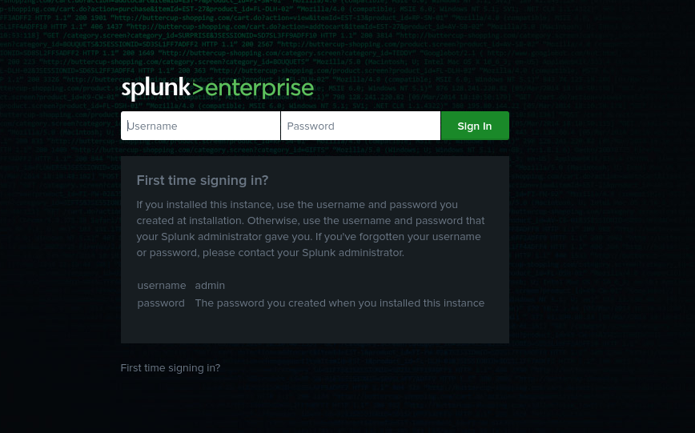

After logging in, you land on the main menu:

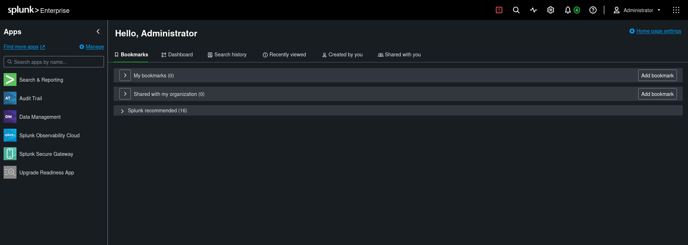

---

## 2. Install Splunk Universal Forwarder (endpoint)

> **Server 2**

We are halfway there. Now we need to install **Splunk Universal Forwarder**, a program installed on hosts (in our case, the endpoint) that sends their logs to the SIEM so they can be monitored for signs of malicious activity.

1. Go to the Splunk website and download Splunk Universal Forwarder as a `.deb` package.
2. Install the package:

```bash
sudo apt install ./splunkforwarder*.deb
```

3. It is installed into `/opt`; once the installation finishes, the `/opt/splunkforwarder` folder appears.
4. As with Splunk, go to the `bin` folder, find the `splunk` executable, and start it:

```bash
cd /opt/splunkforwarder/bin
sudo ./splunk start
```

5. Create a username and password for this endpoint. This is the administrator account used to configure Splunk Forwarder on the host.

---

## 3. Configure data receiving

> **Server 1**

Open the Splunk dashboard on the SIEM server:

1. Click the gear icon (**Settings**) and scroll down to **Forwarding and receiving**.

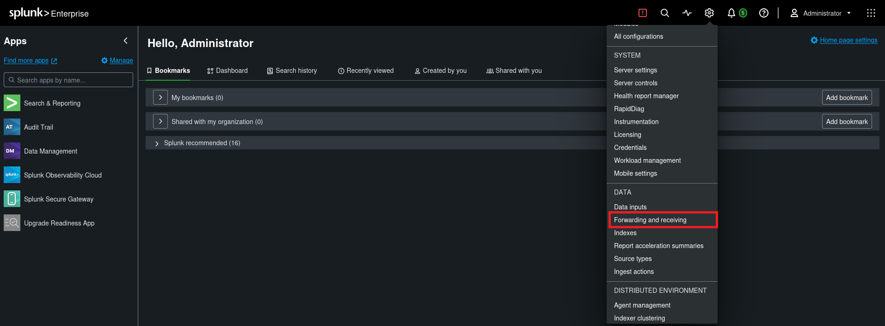

2. Under **Receive data**, click **Add new**.

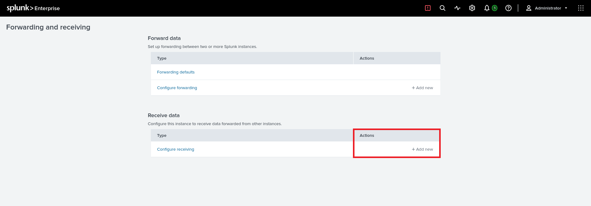

3. In the window that opens, enter the port you are opening on this system to receive data from the endpoint. In my case, it is port `9996`.

This is what the completed configuration looks like:

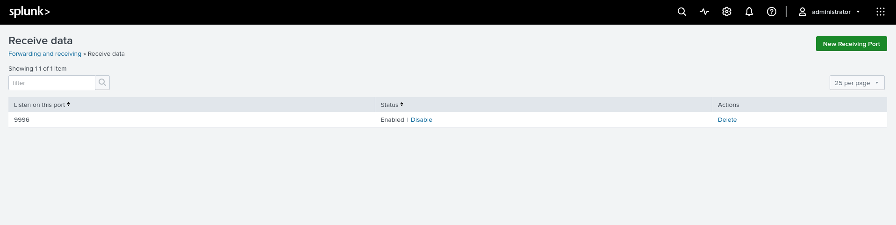

---

## 4. Connect the endpoint to the SIEM

> **Server 2**

On the endpoint, go to `/opt/splunkforwarder/bin/` and run:

```bash
sudo ./splunk add forward-server <SIEM_IP>:<PORT>
```

`SIEM_IP` is the IP address of the SIEM server and `PORT` is the port opened for receiving data (`9996`). I use a private network, so my full command looks like this:

```bash
sudo ./splunk add forward-server 10.147.41.43:9996
```

Splunk then asks for the username and password of the forwarder's administrator account (the one created on the endpoint) to apply the change.

On success, the terminal prints:

```
Added forwarding to: 10.147.41.43:9996
```

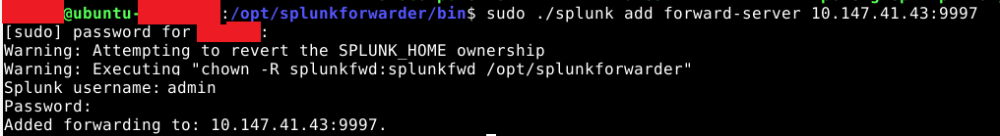

### Verify the connection

> **Server 1**

In the Splunk dashboard on the SIEM server, open the **Search** tab and run:

```spl
| tstats count where index=_internal by host
```

This lists all hosts connected to the SIEM, including the main server where Splunk itself runs.

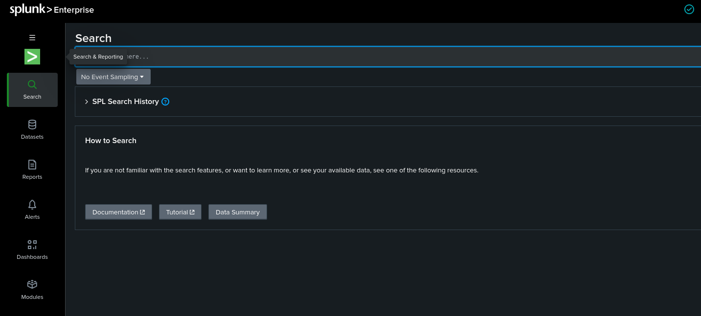

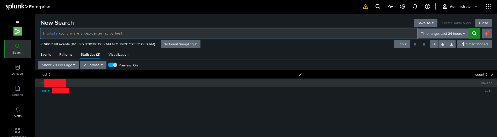

---

## 5. Create an index

> **Server 1**

Indexes make it easy to separate logs from one or several endpoints. An index groups specific logs so that Splunk shows only the data you selected rather than everything at once.

1. Click the gear icon, scroll to the **DATA** section, and open **Indexes**.

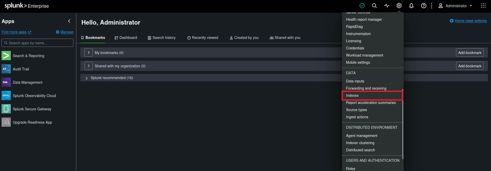

2. On the Indexes page, click **New Index** in the top-right corner.
3. In the window that opens, you don't need to change anything: the default settings are enough.

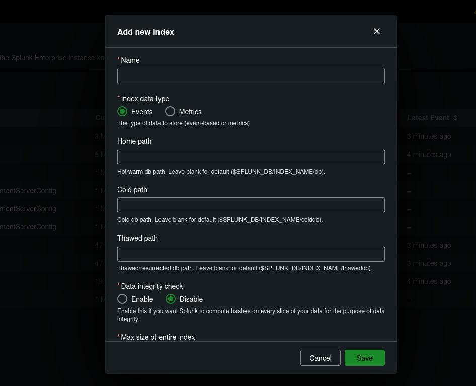

4. The only thing we change is the index name. Let's call it `ssh_logs`.
5. Click **Save**.

`ssh_logs` now appears among the default indexes:

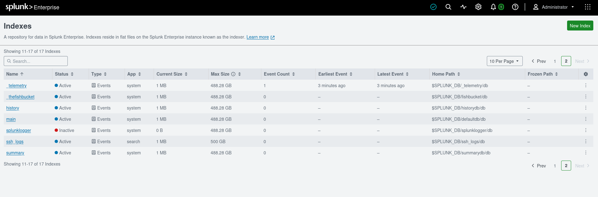

---

## 6. Monitor logs

> **Server 2**

The last step is to tell Splunk which logs we want to monitor on the endpoint.

On the endpoint, run:

```bash
cd /opt/splunkforwarder/bin
sudo ./splunk add monitor /var/log/auth.log -index ssh_logs
```

This adds `auth.log` to monitoring: whenever the file changes, the new events show up in the SIEM.

> **Note:** `/var/log/auth.log` is used on Debian/Ubuntu. On RHEL, CentOS, Rocky, Alma, and Fedora, use `/var/log/secure`.

After adding the monitor, it is recommended to restart Splunk Forwarder on the endpoint:

```bash
sudo ./splunk restart
```

> **Server 1**

Now open the Search page in Splunk and run:

```spl
index=ssh_logs
```

The `/var/log/auth.log` events from the endpoint are displayed.

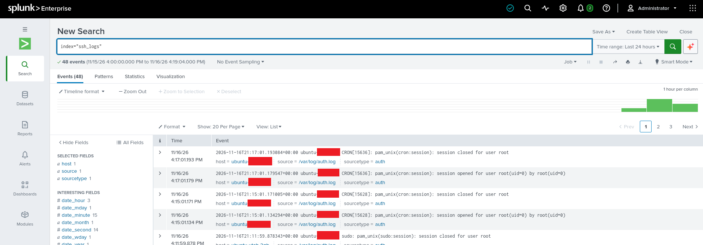

You can now collect and analyze logs.

> If logs are not updating in the SIEM even though there was activity on the endpoint, pick the appropriate period in the **Time Range** drop-down. In my case, I selected **All time**.

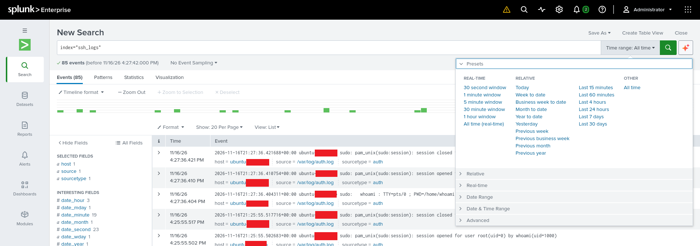

---

## 7. Honeypots: FTP and Apache

> **Server 2**

I also set up two additional services, **FTP** and **Apache2**, to use as honeypots.

### FTP

- Placed a harmless, empty decoy file on the server.
- Allowed connections only with the `anonymous` login.
- **Goal:** analyze how attackers get access to the FTP directory and download the file.

### Apache2

- Changed the server banner to the vulnerable version **Apache 2.4.50**, which allows path traversal (CVE-2021-41773).
- **Goal:** capture in Splunk how attackers try to send payloads to my website, while nothing actually works for them.

For each service I created a separate index, `ftp_logs` and `apache_logs`, and added the corresponding logs to them.

### Searching multiple indexes

To show several indexes at once in the SIEM, use the `OR` operator:

```spl
index=ssh_logs OR index=ftp_logs OR index=apache_logs
```

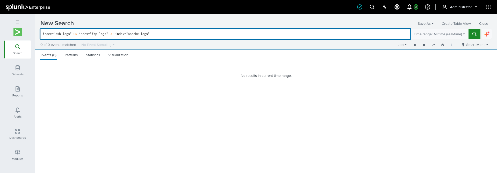

---

## 8. Results

I left the server running, hoping that someone would take an interest in it so that I could record an attacker's activity in the logs. Within a couple of hours, my server was already being scanned:

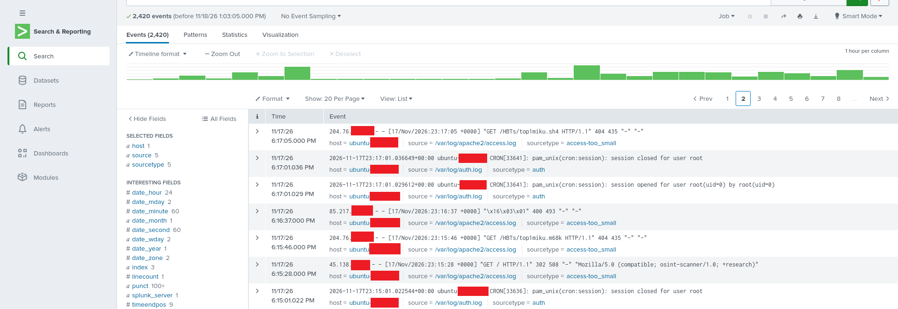

### Overview

| Metric | Value |
|---|---|
| Total events collected | **2,420** |
| Monitored host | 1 (`ubuntu-utah-2gb`) |
| Indexes | 3 (`ssh_logs`, `ftp_logs`, `apache_logs`) |
| Log sources | 5 (including `/var/log/auth.log` and `/var/log/apache2/access.log`) |
| Observation window | 2 calendar days |

The timeline (1 hour per column) shows that activity was continuous, with several noticeable spikes. Scanning did not stop at any point during the observation period.

### Observed attacker activity (Apache honeypot)

The Apache honeypot, which advertises the vulnerable version 2.4.50, attracted several different kinds of automated traffic:

| Source IP | Request | Response | Interpretation |
|---|---|---|---|
| `204.76.*.*` | `GET /HBTs/top1miku.sh4`, `GET /HBTs/top1miku.m68k` | `404` | Botnet-style scanner looking for malware payloads. The file names end with CPU architectures (SH4, m68k), typical of IoT malware droppers. |
| `85.217.*.*` | Raw bytes `\x16\x03\x01` | `400` | A TLS handshake sent to a plain HTTP port. The scanner was probing for services without knowing what is running. |
| `45.138.*.*` | `GET /` with User-Agent `osint-scanner/1.0; +research` | `302` | Internet-wide research scanner that openly identifies itself. |

All of these requests failed (`404` / `400`) or were harmless redirects, because the honeypot hosts no real content.

### Baseline activity (`auth.log`)

The `auth.log` entries visible in the screenshot (`pam_unix(cron:session)` opening and closing root sessions) are regular scheduled cron jobs, not attacks. They were useful as a baseline for separating normal system activity from malicious activity.

### Conclusion

A freshly exposed server with no public domain name and no content was discovered and probed by automated scanners and botnet-style tools within hours. This confirms that any internet-facing host should be monitored from the first minute it goes online, and that a SIEM such as Splunk makes this activity easy to see and analyze.
